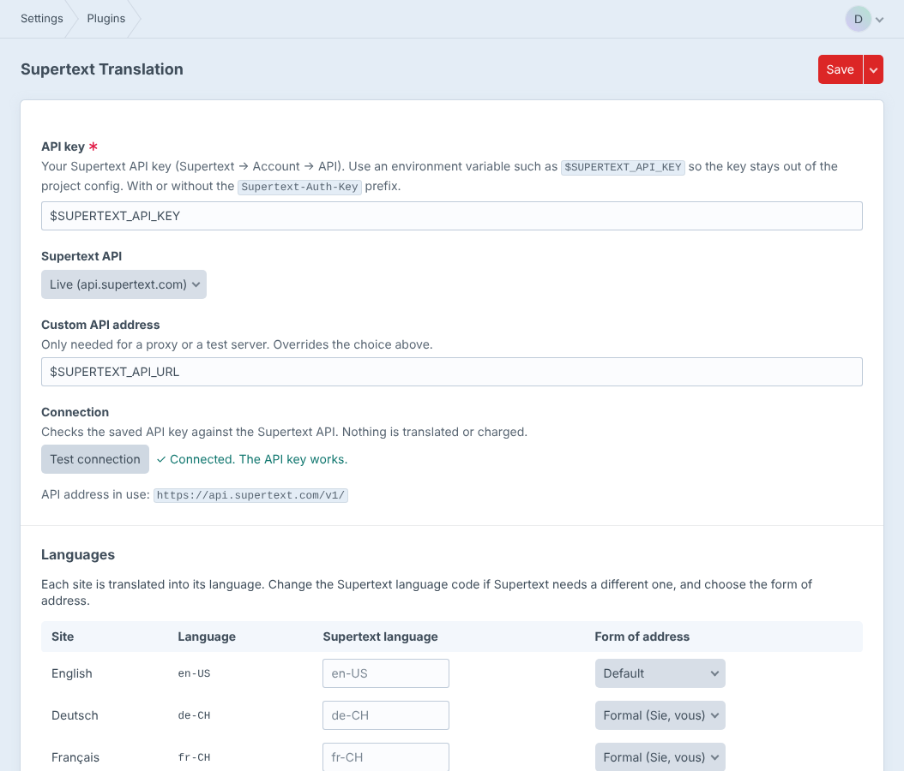
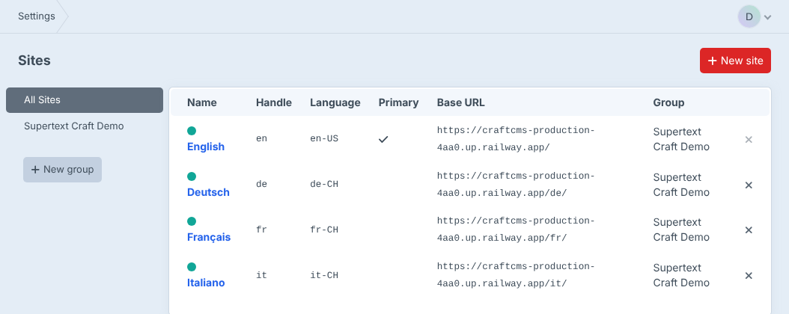
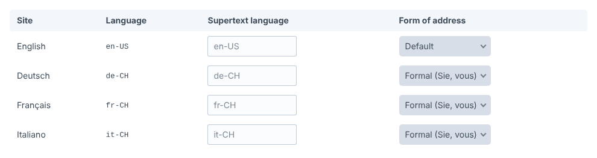

# Installation guide — Supertext Translation for Craft CMS

For administrators who install and set up the plugin. Editors find their part in the [user guide](USER_GUIDE.md).

## Requirements

- Craft CMS 5 (any edition; giving editors their own permissions needs user groups, i.e. Craft Team or Pro), PHP 8.2 or later
- A multi-site setup: one site per language, e.g. *English* (`en-US`), *Deutsch* (`de-CH`), *Français* (`fr-CH`)
- Sections whose entries exist in those sites (*Propagation method* other than "Only save entries to the site they were created in")
- A Supertext account with an API key (see [API key](#api-key))
- The server must reach `https://api.supertext.com` over HTTPS (and, for [Translation review](#translation-review), Supertext's review service)

## Install

The plugin is not in the Plugin Store yet. Install it with Composer from this repository:

```bash
composer config repositories.supertext vcs https://github.com/Supertext/CraftCms-Supertext-Translation
composer require supertext/craft-supertext-translation:dev-main
php craft plugin/install supertext-translation
```

Or install it in *Settings → Plugins* after the `composer require`. Installing creates two small database tables: `supertext_translations` (when an entry was last translated into a site) and `supertext_state` (the latest API key check and what was last sent as version information, see [Version information and the API key check](#version-information-and-the-api-key-check)).

### Update

```bash
composer update supertext/craft-supertext-translation
php craft up
```

`php craft up` runs the plugin's migrations (e.g. the `supertext_state` table added with the API key check).

### Uninstall

*Settings → Plugins → Supertext Translation → Uninstall* (or `php craft plugin/uninstall supertext-translation`), then `composer remove supertext/craft-supertext-translation`. Translations already made are normal entry content and stay; only the plugin's table and settings are removed.

## API key

You need a Supertext account and an API key:

- **Account**: no Supertext account yet? [Log in or create a Supertext account](https://www.supertext.com/person/en/account/signin) with your e-mail address.
- **API key**: generate it at [supertext.com → Integrations → API](https://www.supertext.com/en/integrations/api). This requires the **Admin** role in your Supertext account; ask your Supertext admin if you don't see the page.

The **API key** field in the plugin settings links to both pages.

1. Add the key to the server's environment, e.g. in `.env`:

   ```bash
   SUPERTEXT_API_KEY="your-key"
   ```

   You can paste it with or without the `Supertext-Auth-Key ` prefix that Supertext shows. The plugin sends it as `Authorization: Supertext-Auth-Key <key>`.
2. *Settings → Plugins → Supertext Translation*: the **API key** field already contains `$SUPERTEXT_API_KEY`. Keep the variable reference there: the setting is stored in the project config, and with the reference the key itself never ends up in your repository.
3. Save the settings. The plugin then checks the key automatically (a cost-free call to the Supertext API; nothing is translated or billed) and shows the result: *API key checked: the connection to Supertext works.*, *Supertext rejected the API key* (with the links to create an account and generate a key), *No API key is set yet*, or that Supertext couldn't be reached. An invalid key never blocks saving. The **API key check** on the settings page shows the latest result with its time; **Test connection** checks again.



## Languages

The plugin translates into the **language of each site**. Set the languages in *Settings → Sites*; use regional codes where they matter (`de-CH` writes "ss" instead of "ß", `fr-CH` and `it-CH` use Swiss conventions).



In the plugin settings, the **Languages** table lists every site. Per site you set:

- **Supertext language**: a select with Supertext's own list (each language's name in your control panel language and its code, e.g. *Deutsch (Schweiz) (de-CH)*): the language Supertext translates into, and from when the site is the source. You never type a code. Until you save a choice, the select shows a suggestion:
  - the site's language itself when it **is** a Supertext code (apart from upper/lower case and `_`/`-`), e.g. `de-CH`, `fr_ch` → `fr-CH`, `es`;
  - else its usual variant (the defaults below), e.g. a site in `de` → *German (Germany)* `de-DE`; choose *German (Switzerland)* `de-CH` or *German (Austria)* `de-AT` if that's what the site is;
  - else *— choose —*, marked *Not mapped*: the site's language has no obvious Supertext language (e.g. `en-IE`, `de-LI`, `fr-BE`, `gsw`, `sr-RS`). It isn't translated until you choose one (editors see *The language … has no Supertext language yet*); the other sites are.

  A site you haven't saved a choice for is translated with the same suggestion, so saving the page only makes it explicit. Saving checks every value against Supertext's list.
- **Form of address**: *Formal* (Sie, vous), *Informal* (du, tu) or *Default*. Shown only for Supertext languages that offer the choice; English, Swiss German, Romansh, Albanian and Serbian show *Not offered for this language* (always *Default*).
- **Translation review**: on or off (off by default), see [Translation review](#translation-review).

Defaults for a site language that isn't a Supertext code itself (the Supertext SDK's, the same in every Supertext plugin):

| Site language | Supertext language |
| --- | --- |
| `de`, `en`, `fr`, `it`, `pt` | `de-DE`, `en-US`, `fr-FR`, `it-IT`, `pt-PT` |
| `zh`, `zh-CN`, `zh-SG` / `zh-TW`, `zh-HK`, `zh-MO` | `zh-Hans` / `zh-Hant` |
| `sr`, `sr-Latn-RS` / `sr-Cyrl-RS` | `sr-Latn` / `sr-Cyrl` |
| A region of a language Supertext offers without region | the bare code: `es-ES`, `es-419` → `es`, `nl-NL` → `nl`, `nb-NO` → `nb` |
| Anything else (`en-IE`, `de-LI`, `fr-BE`, `gsw`, `sr-RS`, `no`) | none: choose one |

**Override from a config file:** `config/supertext-translation.php` can set the Supertext language (and form of address and *Translation review*) per site handle, e.g. for automated setups; it wins over the settings page, where that site's select is then disabled with the note *Set in config/supertext-translation.php* (a `review` set there disables that site's *Translation review* switch):

```php
<?php
return [
    'languages' => [
        'german' => ['code' => 'de-CH', 'politeness' => 'more', 'review' => true],
    ],
];
```

Supertext accepts exactly these codes (its `features` list, October 2026). The source language is always sent without region (`en-US` → `en`), from the same setting.

| Language | Supertext codes |
| --- | --- |
| German, English, French, Italian, Portuguese | `de-DE`, `de-CH`, `de-AT`, `en-US`, `en-GB`, `fr-FR`, `fr-CH`, `it-IT`, `it-CH`, `pt-PT`, `pt-BR` |
| Chinese, Serbian | `zh-Hans`, `zh-Hant`, `sr-Latn`, `sr-Cyrl` |
| Swiss German | `gsw-u-sd-chzh` (Zurich), `gsw-u-sd-chbe` (Bern) |
| All others, without region | `bg`, `cs`, `da`, `el`, `es`, `fi`, `hr`, `hu`, `ja`, `ko`, `nb`, `nl`, `pl`, `rm`, `ru`, `sk`, `sl`, `sq`, `sv`, `tr` |

**Updating from an older version:** `php craft up` converts the Supertext languages saved by older versions (which could hold other spellings) to the list's: `de_ch` → `de-CH`, `de` → `de-DE`, `es-ES` → `es`. A value that is no Supertext language (e.g. `xx-YY`) is removed, logged as a warning, and the site shows its select again (with the suggestion or *— choose —*).



## Translation review

With **Translation review**, people check the translations on the website itself and correct them there: customers or Supertext linguists open the original and the translated page side by side in Chrome with the *Supertext Localization Review* extension and fix texts in a side panel. Their corrections come back into Craft.

Turn it on per language for the site that is translated **into** (*Settings → Plugins → Supertext Translation → Languages*, switch **Translation review** on in that site's row, e.g. *Deutsch* → **Save**). Switch it off to turn it off again; nothing else changes.

- Translations into that site then go through Supertext's review service instead of directly to Supertext. It answers exactly like Supertext and passes everything on with your API key, so billing, languages, form of address and error messages stay the same. Other sites keep going directly to Supertext.
- The review service keeps every translation of your account. A text it has translated before gets the same translation again (without a new Supertext call), and once a reviewer has corrected it, the corrected text.
- **Corrections arrive with the next translation:** after a review, translate the entries into that site again (*Translate with Supertext*, with *Overwrite existing translations*) to write the corrections into Craft. As always, overwriting replaces manual changes in the translated fields (the previous version stays in the revisions).
- Reviewers get a review link for your site from Supertext; nothing to set up in Craft.
- The review service works with keys of the **live** Supertext API. With *Supertext API* set to *Staging* or *Testing* (or a *Custom API address*), leave review off.
- *Export for translation* and *Import translation* don't use the review service. The automatic API key check and *Test connection* still go directly to Supertext.
- **Review service address** (in the plugin settings) is Supertext's review service by default. Leave it as it is unless Supertext gives you another address; empty turns Translation review off for every site. `SUPERTEXT_REVIEW_URL` in the server's environment wins over the setting (also when empty).

## Which fields are translated

The plugin translates fields that are translatable in Craft: their **Translation Method** (in the field's settings, or the field layout override) is anything but *Not translatable*. Fields that are the same in every site are left alone. Supported field types: Plain Text, CKEditor (and Redactor), Matrix (the fields of its nested entries), plus each entry's title and slug. Details in the [user guide](USER_GUIDE.md#what-is-translated).

## Permissions

Editors need, in their user group (*Settings → Users → User Groups*):

- **Supertext → Translate entries with Supertext**
- *Access the control panel*, *Edit* permission for **each site** they translate into (*Sites → Edit "Deutsch"*, …)
- The section's *View entries* and *Save entries* (and *View/Save other authors' entries* if the entries aren't theirs)

The plugin checks that the editor may save the entry in every target site before anything is sent to Supertext. Sites they can't edit don't appear in the Supertext box.

**Export for translation / Import translation** (XLIFF 1.2 or HTML files, in the Supertext box) need the same permission; an import saves only into sites where the editor may save the entry, each entry and site in the file is checked. Uploads are limited to 10 MB (PHP's `upload_max_filesize` and `post_max_size` must allow that much, or larger files are refused earlier) and are only read in memory, never stored. There is nothing to configure, and no API key is needed for files.

## Settings

All settings are in *Settings → Plugins → Supertext Translation* and stored in the project config (change them where admin changes are allowed, e.g. in development, and deploy them).

| Setting | Default | Description |
| --- | --- | --- |
| API key | `$SUPERTEXT_API_KEY` | The key or an environment variable reference. Required. |
| Supertext API | Live | *Live* (`https://api.supertext.com/v1/`), *Staging* or *Testing*. |
| Custom API address | – | A different base URL (proxy, test server); may be an environment variable such as `$SUPERTEXT_API_URL`. Overrides *Supertext API*. For [Translation review](#translation-review) use the sites' switch instead. |
| Review service address | Supertext's review service | Address of the review service for sites with *Translation review* on; may be an environment variable reference. Empty turns review off for every site. `SUPERTEXT_REVIEW_URL` on the server wins. Only change it when Supertext gives you another address. |
| Languages | the suggestion | Per site: Supertext language (a select of Supertext's list; preselected with the site's language or its default, `de` → `de-DE`; *— choose —* where there is none), form of address (only where Supertext offers it) and *Translation review* (off by default, see [Translation review](#translation-review)). `config/supertext-translation.php` → `languages` overrides it. See [Languages](#languages). |
| Timeout | 180 | Seconds to wait for the translation of one site. |
| Send version information to Supertext | On | See [Version information and the API key check](#version-information-and-the-api-key-check). The environment variable `SUPERTEXT_VERSION_REPORTS=0` (or `false`, `off`, `no`) on the server turns it off regardless of the setting (`1` turns it on). |

Translated slugs follow Craft's own slug rules: set `limitAutoSlugsToAscii` in `config/general.php` to get `chocolat-suisse-expedie` instead of `chocolat-suisse-expédié`.

## Version information and the API key check

**Send version information to Supertext** is on by default. The plugin then sends the site URL and the versions of this plugin, Craft CMS and PHP to Supertext when you save the plugin settings and after an update, so Supertext support can see which version you run. A report contains exactly: the site URL (the primary site's base URL), the plugin's name and version, the Craft CMS and PHP versions, the Supertext SDK version, whether an API key is set, the result of the API key check (status, time, HTTP status, Supertext's error code) and the address of the ping endpoint below. **No content, no API key and no personal data are sent.** Reports go from the Craft server, never from the browser, at most 3 seconds each; a report that fails is not retried for an hour and never slows down or breaks a save or a translation. To turn it off, switch the setting off and save, or set `SUPERTEXT_VERSION_REPORTS=0` in the server's environment: nothing is sent at all then, and the ping endpoint answers 404.

When reports are sent:

- after every save of the plugin settings (`installed` the first time, then `settings_saved`);
- after an update of the plugin, Craft CMS or PHP, noticed on the next control panel request that uses the plugin (the settings page, the Supertext box, a translation, a queue job or console command), after the response has been sent;
- when the result of the API key check changes (e.g. Supertext rejects the key during a translation);
- by `php craft supertext-translation/translate/check`.

**The API key check** runs whether or not version information is sent: after every save of the settings, on **Test connection**, on the next request after the key in the environment changed (the plugin compares a fingerprint of the key kept in its table, never the key itself), and when Supertext rejects the key during a translation. It's Supertext's cost-free `features` call. The settings page shows the latest result with its time.

**The ping endpoint** `GET <site URL>/actions/supertext-translation/ping?challenge=…` (`index.php?p=actions/supertext-translation/ping` without `omitScriptNameInUrls`) is public (no login, no session, no CSRF token) and answers only `{"ok":true,"plugin":"CraftCms-Supertext-Translation","challenge":"…"}` with `Cache-Control: no-store`, so Supertext can see that the site is reachable from the internet. It returns nothing else: no versions, no settings, no data. Exclude it from static page caches (most exclude action requests anyway). The settings page shows its address while reports are on.

The plugin keeps this state (what was reported last, the latest key check, the key's fingerprint) in its table `supertext_state`.

## Interface languages

The plugin's box, settings, permission and messages are available in English, German, French and Italian. They follow each user's control panel language: *My Account → Preferences → Language* (or the system default in `config/general.php`, `defaultCpLanguage`). Other languages show the English texts.

## Background translation

The entry index action *Translate with Supertext* translates in Craft's queue. Craft runs the queue automatically on control panel requests; on busy or headless setups run a queue worker (`php craft queue/listen`) or a cron job (`php craft queue/run`).

## Troubleshooting

| Symptom | Cause and fix |
| --- | --- |
| No Supertext box on the entry page | Craft has only one site, the entry exists in only one site, or the user lacks the *Translate entries with Supertext* permission. |
| *Supertext is not set up yet* | The API key setting is empty or its environment variable isn't set on this server. |
| *Authentication failed. Please check the Supertext API key.* | Wrong or revoked key, or a key for another environment (*Live* vs *Staging*). Use *Test connection*. |
| *Supertext rejected the API key* (API key check) | The key is wrong or revoked. Check that the whole key is in `SUPERTEXT_API_KEY`, or generate a new one at [supertext.com → Integrations → API](https://www.supertext.com/en/integrations/api) (Admin role required). No Supertext account yet? [Create one](https://www.supertext.com/person/en/account/signin). Then *Test connection*. |
| *The API key couldn't be checked because Supertext can't be reached* | The Craft server can't reach `api.supertext.com` (firewall, proxy, DNS). Translations need the same connection. |
| *The language … has no Supertext language yet* / *Not mapped* in the Languages table | The site's language is no Supertext code and has no default (e.g. `en-IE`, `de-LI`, `gsw`). Choose its *Supertext language* under *Settings → Plugins → Supertext Translation → Languages* (see [Languages](#languages)). |
| *Supertext offers no formal or informal tone for this language* | *Form of address* is *Formal* or *Informal* for a language without that choice (English, Swiss German, Romansh, Albanian, Serbian), saved by an older version or set in `config/supertext-translation.php`. Save the settings page once (it resets the hidden choice to *Default*) or fix the config file. |
| *Authentication failed* only for sites with *Translation review* | The review service only works with keys of the live Supertext API: with *Staging*/*Testing* (or a *Custom API address*) leave review off. |
| Reviewers' corrections don't show up in Craft | They arrive with the next translation: translate the entries into that site again with *Overwrite existing translations*. Check that the site's *Translation review* is on and *Review service address* isn't empty. |
| *You are not allowed to edit the entry in this site.* | The editor lacks *Edit* permission for that site or the section's save permissions. |
| *The entry is not available in this site.* | The section doesn't propagate the entry to that site. Enable the site in the entry's *Status* panel or change the section's propagation. |
| *Supertext does not support this language pair (en → xx-YY)* | A code from `config/supertext-translation.php` that Supertext doesn't offer, or the same language as the source. Use a code from the list; the message shows the codes that were sent. |
| *Choose the Supertext language of site … from the list* when saving | A value that isn't one of Supertext's codes was posted. Choose one from the select. |
| *Too many requests to Supertext* | The API's per-second limit was hit repeatedly although the plugin retries. Try again shortly. |
| *Your Supertext translation limit is exceeded.* | The Supertext subscription's quota is used up. |
| *Timed out waiting for the Supertext translation* | Very long content. Raise *Timeout* (and PHP's `max_execution_time`). |
| *The file is too large (at most 10 MB)* for a smaller file | PHP's `upload_max_filesize` or `post_max_size` is lower than the file; raise them. |
| *This file belongs to another system* / *This file wasn't exported by the Supertext plugin* | The file comes from another Supertext plugin, or the translation tool removed the file's header (HTML: the `supertext:` meta tags; XLIFF: the `<file>` attributes). Export again and keep them. |
| A field isn't translated | Its Translation Method is *Not translatable*, or its type isn't supported (see above). |
| Bulk translations don't run | The queue isn't running (see *Background translation*). Failed jobs show the reason in *Utilities → Queue Manager*. |

Errors are also written to Craft's log (`storage/logs/`). More technical details are in the [developer guide](DEVELOPER.md).
